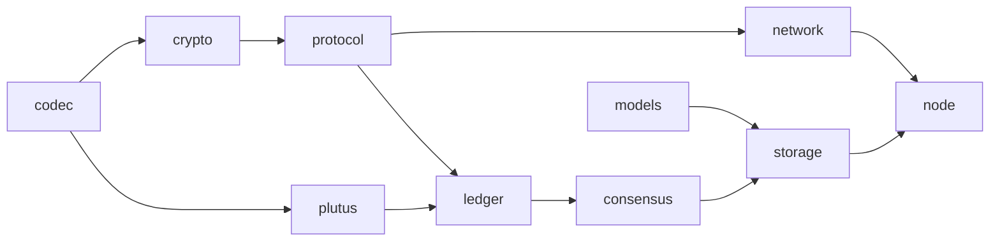

<p align="center">
  
</p>

<h1 align="center">Scarab</h1>

<p align="center"><strong>A Cardano™-compatible node in functional Scala 3</strong><br>
tagless-final cats-effect · cats-mtl · checked against the Haskell node, block for block</p>

<p align="center">
  <a href="https://github.com/KD5UJC-XYZ/scarab/actions/workflows/ci.yml"></a>
  <a href="https://github.com/KD5UJC-XYZ/scarab/actions/workflows/e2e.yml"></a>
  <a href="https://github.com/KD5UJC-XYZ/scarab/actions/workflows/fuzz.yml"></a>
  <a href="https://github.com/KD5UJC-XYZ/scarab/actions/workflows/cuddle-crosscheck.yml"></a>
  <br>
  <a href="https://github.com/KD5UJC-XYZ/scarab/releases"></a>
  <a href="LICENSE"></a>
  
  
  
</p>

> [!WARNING]
> **Unofficial research software. Not audited.** Do not use it with mainnet funds or to run production
> stake pools. Scarab is not affiliated with or endorsed by Input Output Global, Intersect, the Cardano
> Foundation or EMURGO, and is not the Cardano node software they distribute. "Cardano" is used only to
> describe protocol compatibility; it is a trademark of the Cardano Foundation, CHE-184.477.354,
> Dammstrasse 16, 6300 Zug, Switzerland, in Switzerland and other countries. See [SECURITY.md](SECURITY.md),
> [NOTICE](NOTICE) and [docs/licenses.md](docs/licenses.md#name-and-trademark-wording).

Scarab is an independent implementation of a Cardano node, written so that it can be read and reasoned
about: effects are abstract (`F[_]`), domain errors are closed types raised through cats-mtl, the rules
are pure functions over values, and the algebras carry cats-laws and ScalaCheck properties. The
[Haskell node](https://github.com/IntersectMBO/cardano-node) is the reference: its types are the model
for ours, its formats are what we read and write, and every claim of compatibility below is a run
against it.

## What it does

| | |
|---|---|
| **Eras** | Byron (PBFT, ledger, update system) through Shelley, Allegra, Mary, Alonzo, Babbage and Conway, including the hard forks between them |
| **Consensus** | TPraos and Praos header validation (VRF, KES, operational certificates, nonces, leader schedule), chain selection, the hard-fork combinator |
| **Ledger** | Every Shelley-based rule set; native scripts and Plutus V1 to V3 (evaluator: [Scalus](https://github.com/scalus3/scalus), behind our own interface); all certificates; Conway governance (proposals, votes, DReps, ratification, enactment) |
| **Networking** | Node-to-node ChainSync, BlockFetch, TxSubmission2 and KeepAlive, client and server; inbound and duplex connections; serves a Haskell relay |
| **Node** | Persistent chain (immutable and volatile stores, ledger snapshots, a RocksDB UTxO set), mempool, Praos block forging, node-to-client LocalStateQuery / LocalTxSubmission / LocalTxMonitor / ChainSync |
| **Haskell formats** | Reads the Haskell ImmutableDB; reads and writes the Haskell ledger-state file byte for byte (see below) |

## Verified against the Haskell node

| Check | Result |
|---|---|
| **Preview ledger state (K1)** | At the first block of every Preview epoch, our ledger state against the one `cardano-node` 11.1.3 stores: **1,451 of 1,451 epoch boundaries equal**, 0 differences, through Alonzo, Babbage and 806 epochs of Conway governance |
| **Preprod, genesis to tip (C4)** | One build, one uninterrupted run: **5,295,553 blocks** through Byron and every Shelley-based era in 4 h 52 min, **0 errors**; tip equal to Koios |
| **Preview, genesis to tip** | 4,748,226 blocks in 3 h 37 min on one build, 0 errors; 3.2M Plutus evaluations, each verdict equal to the chain's `is_valid` |
| **Haskell ledger-state file** | The 40.6 MB Preview `state` file written by `cardano-node`, and a devnet `state` file of each era from Byron to Conway, decoded and **re-encoded byte for byte** |
| **Devnet scenarios** | Against Haskell nodes on a local cluster: Byron→Conway follow with per-era ledger comparisons (`e2e`), governance and Plutus load (`soak`), a Haskell relay fed only by Scarab (`relay`), Scarab forging as a stake pool (`pool`), node-to-client answers byte-compared (`ntc`) |
| **Plutus conformance** | The upstream `plutus-conformance` suite (plutus 1.70.0.0): 987 of 1,009 cases; the rest are classified ([issues filed upstream](docs/compatibility.md)) |
| **Fuzzing** | Every decoder entry point under structured fuzzing, nightly |

Real-data bugs found along the way are pinned by tests and listed in [docs/findings.md](docs/findings.md).
The full matrix, with what is **not** yet checked (mainnet, ledger-state identity on preprod, the P2P
governor, Mithril import, a security review), is [docs/compatibility.md](docs/compatibility.md).

## In progress

- **Haskell-shaped ledger state.** The node's state is being mirrored into the Haskell node's own types
  (`NewEpochState`, `ExtLedgerState`, the hard-fork telescope), indexed by era so that a rule cannot
  touch another era's data, and converted both ways losslessly on every real state we have. Next, the
  rules move onto these types and our snapshots adopt the Haskell layout ([#82](https://github.com/KD5UJC-XYZ/scarab/issues/82)).
- **Mainnet**: a full validation of every mainnet block from genesis ([D6, #25](https://github.com/KD5UJC-XYZ/scarab/issues/25)).
- **Ouroboros Leios** (CIP-164): design note and BLS12-381 voting primitives ([docs/leios.md](docs/leios.md)).

Everything planned, with stable IDs, is in [docs/roadmap.md](docs/roadmap.md).

## How it is written

```scala
// The era is a type. A Conway ledger state carries Conway's certificate and governance state, and a
// rule written for one era does not compile against another's data.
final case class LedgerState[E <: EraTag](cert: CertState[E], utxo: UTxOState[E])

type GovState[E <: EraTag] = E match
  case Shelley => ShelleyGovState
  // ... Allegra, Mary, Alonzo, Babbage likewise
  case Conway  => ConwayGovState

// Capabilities, not concrete effects: configuration through Ask, typed failure through Raise.
def apply[F[_]: Monad](using Ask[F, MirrorEnv], Raise[F, MirrorError]): LedgerMirror[F]
```

- **Tagless final** at every effect boundary; `IO` appears only in `Main` and the tools.
- **Closed error types** raised with `Raise` and handled with `Handle`; no exceptions for domain errors,
  no stringly-typed control flow.
- **Original bytes kept**: whatever is hashed or signed is hashed over the bytes as received.
- **Exact arithmetic** (`Rational`) in the ledger; no floating point except where Haskell has it.
- **Laws and properties**: cats-laws, monocle-law and ScalaCheck properties on the algebras, codecs and state conversions.

The design is described in [docs/architecture.md](docs/architecture.md); the rules for contributions in
[CONTRIBUTING.md](CONTRIBUTING.md).

## Quick start

Docker and Python 3 are all the host needs; there is no host JDK or sbt.

```sh
# 1. The JDK image used to build and run
docker build -f docker/jdk.Dockerfile -t scarab-jdk:local .

# 2. Build and test: formatting check, compile with -Werror, every module's tests (about 2,400)
docker run --rm -v "$PWD":/work -w /work --user "$(id -u):$(id -g)" -e HOME=/work/.cache/home \
  scarab-jdk:local bash scripts/sbtw check node/runtimeClasspathFile

# 3. Follow a network from genesis (flags and the Preview example in docs/running.md)
java -cp "$(cat node/target/runtime-classpath.txt)" xyz.kd5ujc.scarab.node.Main follow \
  --genesis-dir <config dir> --peer <host>:<port> --db "${SCARAB_DATA_DIR:-/tmp/scarab}/db"
```

Step 3 needs JDK 21, or run it inside the image. The scenarios against the Haskell node also need the
reference image, built from the checksum-pinned official release ([docs/reference-image.md](docs/reference-image.md)):

```sh
python3 scripts/devnet.py soak --seconds 480    # also e2e, relay, pool, ntc; then `down`
```

Run data goes to `${SCARAB_DATA_DIR:-/tmp/scarab}`, never into the checkout or your home directory.
What each scenario asserts is in [docs/running.md](docs/running.md).

## Modules



Each module may depend only on those before it; sbt enforces the direction.

<details>
<summary>What each module holds</summary>

| Module | Contents |
|---|---|
| `codec` | CBOR with original-bytes preservation, `Bytes`, exact `Rational` |
| `crypto` | Blake2b, strict Ed25519, VRF (verify and prove), Sum6 KES, BLS12-381, operational certificates |
| `protocol` | Pure Ouroboros mini-protocol codecs and state machines |
| `network` | fs2 bearer, multiplexer, handshake, client and server roles of every mini-protocol |
| `plutus` | The Plutus evaluator algebra and its Scalus adapter |
| `ledger` | Blocks, headers, genesis, transactions, the Byron to Conway rules, and the era-indexed Haskell-shaped state (`ledger.state`) |
| `consensus` | Praos, TPraos and PBFT, chain selection, the hard-fork combinator, header rules, the consensus side of the state (`consensus.state`) |
| `storage` | Immutable and volatile stores, ledger snapshots, the UTxO store, format migrations, the Haskell ImmutableDB reader and ledger-state codec |
| `node` | Peers, follower, relay, mempool, forging, node-to-client, query server, `Main` |
| `models-gen`, `models` | A CDDL parser and code generator; the models generated from the pinned upstream CDDL (a spike: used by tests, and its runtime by the ledger-state codec in `storage`) |
| `fuzz` | Structured fuzzing of every decoder |

Alongside: `fixtures/` (test vectors and captured chain data, each with its provenance), `scripts/`
(`devnet.py` scenarios, the pinned `sbtw` launcher), `docs/`.
</details>

## Documentation

| | |
|---|---|
| [Architecture](docs/architecture.md) | Layers, algebras, error model, data flow, on-disk formats |
| [Running](docs/running.md) | Every `follow` flag, devnet scenarios, data directories, fuzzing |
| [Compatibility](docs/compatibility.md) | The matrix: what is checked against what, and what is not |
| [Findings](docs/findings.md) | What real chain data taught us, with the tests that pin it |
| [Implementer notes](docs/implementer-notes.md) | Reference behaviours another node must replicate, and where the specification or CDDL differs from the reference |
| [Performance](docs/performance.md) | Sync numbers, profiles, memory and disk |
| [Roadmap](docs/roadmap.md) | Tracked work with stable IDs |
| [Process](docs/process.md) | How work moves from idea to done; the definition of done |
| [Decisions](docs/adr/README.md) | Architecture decision records |
| [Designs](docs/design/README.md) | Approved plans for large work, by stage |
| [Models](docs/models.md) | The CDDL generator and the models generated from it (a spike: tests and the ledger-state codec use it, the node does not yet) |
| [Leios](docs/leios.md) | Ouroboros Leios design note (research, not implemented) |
| [Licences](docs/licenses.md) | Dependency licences, name and trademark wording |
| [Reference image](docs/reference-image.md) | Building the Haskell reference node image |
| [Changelog](CHANGELOG.md) | Changes by release |

## Contributing, security, licence

Contributions are welcome: read [CONTRIBUTING.md](CONTRIBUTING.md) (Docker-only build, style rules, the
gates each kind of change must pass), [docs/process.md](docs/process.md) and the [Code of Conduct](CODE_OF_CONDUCT.md). Agent
sessions follow [AGENTS.md](AGENTS.md). Report
vulnerabilities privately as described in [SECURITY.md](SECURITY.md). Never commit signing keys.

Licensed under [Apache-2.0](LICENSE). Third-party notices and fixture attributions are in
[NOTICE](NOTICE); resolved dependency licences in [docs/licenses.md](docs/licenses.md).
