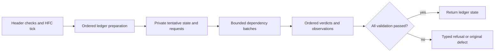

# Bounded parallel Plutus evaluation

**Status: Current, as built.** [D2 #21](https://github.com/KD5UJC-XYZ/scarab/issues/21);
[ADR 0018](../adr/0018-parallel-plutus-after-ordered-preparation.md).

## Execution and ownership

`MirrorRules.applyBlock` and `EraBlock.body` remain pure serial references. The effectful mirror
uses the same header validation and HFC tick, then hands an immutable `EraBlock.Body` to
`ParallelPlutus`. With one worker, or fewer than two redeemer-bearing transactions, it calls the
serial body directly. Otherwise `Body.prepare` runs the same BBODY/LEDGERS rules once, suppressing
only VM execution and observers at UTXOS after the existing phase-1 and script-integrity checks.
Block and transaction execution-unit caps still precede machines. Context collection still precedes
all scripts within its transaction.

A sealed, ledger-private recorder retains jobs. Each job contains the original transaction, exact
spent/reference outputs, parameters, era clock and immutable evaluator requests. The rules continue
using the transaction's advertised validity flag: normal spends/outputs when true; collateral
consumption/return when false. Certificate and governance rules are unchanged. The only information
deferred is the phase-2 verdict and its counters; those counters are not read by later ledger rules.
The tentative result is private to `EraBlock.Plan`. No caller can manufacture a completed value or
obtain its tentative state.

The graph includes every transaction, so non-script transactions transmit paths. Producer/consumer
and read-before-consume edges include normal inputs, reference inputs and collateral. Creation and
consumption use the validity flag; an invalid transaction creates its collateral return at index
`outputs.size`. Shared reference reads may overlap. A script job's level is one plus the largest
script level among its ancestors; ordinary transactions add no level. Batches run in level order.
This is conservative: all contexts have already been frozen before any worker starts. Full state
application and certificates are never executed concurrently.

Within each job every script runs in collection order; all failures, budgets and logs are retained
([I4 result aggregation](script-results.md)). One shared semaphore
bounds jobs across concurrent validations. Non-interruptible `blocking` holds each permit until its
machine returns, including cancellation. Joined fibers return `Phase2.Completed` values and hold no
`Raise`. The owner resolves them by transaction order, calls observers only for reached transactions,
and returns the original typed refusal, unavailability or raw defect. Later failures cannot overtake
earlier refusals. Missing completions are evaluated locally rather than accepted as a success,
and a completion is its plan's own type, so one another plan executed with its own evaluator does
not type-check in this plan's resolution. Preparation retains an original raw defect alongside its recorded prefix. Earlier script refusals
still win; when that prefix passes, the original defect lands without a retry. A transient defect
cannot disappear because a second execution happened to succeed.

On success only phase-2 counters need reconstruction; the already-checked integrity counter comes
from preparation. On any refusal the entire tentative state is discarded. There is no state
publication, persistence, observer output or peer penalty from speculative later jobs. Worker memory
is bounded by one block per caller, and machine concurrency by the shared node bound. Cancellation
latency includes the remaining metered machine execution. A rejected block can perform speculative
later evaluations within the existing block budget. Calls outside the node's mirror (for example
single-transaction mempool admission) retain their serial interpreter.

## Era block runs

An era block run is a body program of the same kind (`Phase2.Program`, whose `Phase2.Plan` gives
batches, executes a job into a value and resolves the values), so `ParallelPlutus` schedules it
with the same bound and the same serial shortcut. Conway's is `ConwayBlockRun.program`; its
`serial` is `ConwayBlockRun.bbody`, the executable reference. The rules reach the scripts of a
transaction in `BabbageUtxos.evalScripts` (`evalPlutusScripts` and the check against the flag,
[Babbage/Rules/Utxos.hs, lines 130–155 and 192–222](https://github.com/IntersectMBO/cardano-ledger/blob/f649f9751074d2ab3de033fc3912f29c9862c1f5/eras/babbage/impl/src/Cardano/Ledger/Babbage/Rules/Utxos.hs#L130)),
after the collection failures are recorded and only while the judgment has none
(`whenFailureFree`). There they hand the non-empty script list and that program to the run's
`Phase2Deferral`: the serial run's runs the program, a preparation's records a job (the
transaction's place, flag and scripts) in the sealed recorder and a marker at that place among
the run's events, and runs nothing. A worker runs a job's scripts with the reference's
`evalPlutusScripts`, which stops at the first with no verdict. Observed, a transaction whose
scripts cannot be collected is told to the capability before the failures are recorded: the serial
run observes it there, a preparation records its observation in the recorder in order beside the
jobs.

Resolution lands the jobs in transaction order. While every verdict is the one its flag announces,
the preparation went as the serial run goes: its result (state, failures, rule defect or raw
defect) is the serial run's, its counters are counted from its events with each job's verdict told
at its marker as UTXOS tells it, and its observations are made from the ledger state each job was
deferred in, as the serial observer makes them, a recorded observation of a transaction whose
scripts were not collected told at its place among them. A job's raw defect is raised as itself
after what was recorded before it is observed; the serial run reaches it in the same place. A rule defect raised after
a failure was recorded ends the run in a refusal on the failures recorded before it, the defect kept
beside them (`ConwayBlockRun.Refusal.Stopped`, #85); the serial run and the preparation map the
judgment's outcome the same way, so the preparation's refusal is the serial run's, and where a job's
verdict is not its flag's the serial run below records that failure before the defect. Unlike the flat rules, the
era rules accumulate every failure, and a recorded mismatch changes what follows it: later scripts
are not run (`whenFailureFree`) and a script with no verdict is named in the state at its raise.
So at the first verdict that is not its flag's, or no verdict, the plan's result is the serial run
itself, every script answered in order by the landed results where the request is the one
answered (the evaluator is a function of the request), and evaluated only where it is not. A raw
defect the preparation ended in after that point is not landed from the preparation: the second
pass runs the rules again and raises what they raise, which after a mismatch is the same defect
(the rules go on) and after a script with no verdict is that script's naming. That second ordered
pass is paid only for a block the node refuses or withholds, never for one it applies. Missing
completions are evaluated locally, and another plan's do not type-check. The era rules use no
recovery that could discard a recorded job.

Dijkstra's era run is a body program of its own, modelled on Conway's: `DijkstraBlockRun.program`,
whose `serial` is `DijkstraBlockRun.bbody` (#85). Its types are Dijkstra's alone; it shares with
Conway's only what no era parameter enters (`Phase2.Program`, `Phase2.Plan`, the recorder,
`TxDependencies`, `ScriptsTold`, `evalPlutusScripts`). Dijkstra's UTXOS is the same function and takes
the same capability, at a batch's top level, with the batch's scripts: its top level's first, then each
sub-transaction's (`plutusScriptsWithContextDijkstraStAnnTx`,
[Dijkstra/UTxO.hs, lines 258–276](https://github.com/IntersectMBO/cardano-ledger/blob/9df9f98cce86c5f2195142b2c02dd9b39dd9dc7c/eras/dijkstra/impl/src/Cardano/Ledger/Dijkstra/UTxO.hs#L258)),
each with the context the rules built from the UTxO set before the batch (`mkDijkstraStAnnTopTx` and
`mkDijkstraStAnnSubTx` take `ltiUTxO` from the set LEDGERS judges the batch on,
[Dijkstra.hs, lines 111–219](https://github.com/IntersectMBO/cardano-ledger/blob/9df9f98cce86c5f2195142b2c02dd9b39dd9dc7c/eras/dijkstra/impl/src/Cardano/Ledger/Dijkstra.hs#L111),
[Babbage/Rules/Ledgers.hs, lines 132–133](https://github.com/IntersectMBO/cardano-ledger/blob/9df9f98cce86c5f2195142b2c02dd9b39dd9dc7c/eras/babbage/impl/src/Cardano/Ledger/Babbage/Rules/Ledgers.hs#L132)).
So a job is a batch, its flag the top level's, and the preparation records it, its place and its
scripts, and a marker at its place among the counters' events. The landing is Conway's without the
observer, which a Dijkstra block does not have: while every verdict is its flag's the preparation's
result is the serial run's, the counters told from the landed verdicts; a raw defect lands as itself; at
the first verdict that is not its flag's, or no verdict, the serial run is the result, each script
answered by a landed result only where its request is the one asked, and the serial run names a script
with no verdict as it always does (its batch, `ScriptLocation.Phase2` or `SubPhase2`, its redeemer).

A batch's footprint (`DijkstraPhase2.footprint`) is every level's. Of the ledger's state the
translations read only the UTxO set, beside the parameters' version, the era history and the system
start, which no transaction of a block changes (`ltiUTxO` in `toPlutusTxInfo` of V1 to V4 and the
spending datum, `Dijkstra/TxInfo.hs`). The batch reads `allInputs`: the top level's inputs, collateral
and reference inputs, and each sub-transaction's inputs and reference inputs. Flagged valid, it consumes
every level's inputs and creates every level's outputs, a sub-transaction's under its own id; flagged
invalid, it consumes the top level's collateral and creates its collateral return, and no
sub-transaction changes the set (`SubUtxo.hs`, lines 255–261). The batches order the evaluation only:
a verdict reaches the result through the ordered landing alone, whatever batch evaluated it.

A body whose transactions declare more execution units than the parameters' `maxBlockExUnits`
(BBODY's `validateExUnits`, which it checks only after LEDGERS) is never prepared: it is not
`worthwhile`, so `ParallelPlutus` runs it serially, and its plan, prepared directly, has no job. The
workers run every recorded job before the first verdict lands, and after a verdict that is not its flag's
the serial run reaches no later script (`whenFailureFree`, over the whole judgment), so a prepared block
can evaluate scripts the serial run does not; the rule bounds that work by the units an admissible block
declares. It does not stop the jobs after an early failure: that would need the scheduler to land each
batch before running the next, which `ParallelPlutus` does not. Conway's era run (`ConwayBlockRun.Body`)
and the flat rules' body (`EraBlock.Body`) prepare on the count of transactions with redeemers alone,
with the same exposure.

The node applies Conway blocks with the era run (the Conway switch, #85), and the Leios build's
Dijkstra blocks with Dijkstra's (`MirrorDijkstra.ready`), each serial or through the workers. A
Dijkstra block's application is split at BBODY: the decoding, the Leios checks, the closure and the tick
run before the program, and BBODY's result, Praos2's header checks against the state ticked before BBODY
and the state's assembly run after it, in `applyHelper`'s order (`Ledger/Extended.hs`, lines 297–311,
ouroboros-consensus d91b3557, the same at 2416493b). The mempool, the forger's and the closure's runs
keep their serial interpreter (`Phase2Deferral.now`; a closure evaluates nothing, `ValidateNone`).

`DijkstraBbodyImpSuite` and `DijkstraBbodySuite` prepare every Dijkstra run they make
(`DijkstraPlanned.check`) and resolve the plan with its jobs run last batch first, with none run, and on
one, two, four and eight threads, each batch's jobs at once: the reference's BBODY cases, among them
`Alonzo/Imp/BbodySpec.hs:49`'s block as eight jobs and the sub-transaction's batch, and crafted blocks
whose scripts read what another batch changes (a sub-transaction spending what an earlier batch's script
read as a reference input, batched `[0] [1]` where its control is `[0, 1]`; a script spending what an
earlier batch's sub-transaction made, `[0] [1]`; a script that fails between two that pass, flagged
invalid, flagged valid, and one that passes flagged invalid; no verdict at the sub-transaction's script
and at the top level's); `DijkstraBbodyImpWorkersSuite` (node) runs the same suite with every
prepared block through `ParallelPlutus` itself at one, two, four and eight workers. Every captured
Dijkstra block and every block of the Leios corpus that decodes (37) is checked the same way, but none
defers a job: no recorded state holds their inputs. `DijkstraParallelSuite` runs the testnet's recorded script transactions, each
block's in a block of its own (173 blocks, 150 admitted, 17 of two or more scripted batches, two in
dependent batches), through `ParallelPlutus` at one, two, four and eight workers, and gives each of the
41 scripts of those 17 blocks no verdict in turn, three of them a sub-transaction's; `MirrorDijkstraSuite`
runs the devnet chain through the node's rules at the same counts. Every result is the serial run's.

On 2026-11-24 (the source that made Dijkstra's run a program, #85) `LeiosReplayMain` replayed window P's
first two hops of the recorded public testnet (985 and 1,010 blocks from the reference's states at slots
1,015,165 and 1,036,794) with `--plutus-workers 1` and `4`: all four runs ended `matched`, `state`, `tables`
and `meta` byte for byte the reference's. Of those hops' ranking blocks, 171 and 128 hold two or more
transactions with redeemers (one of them three), each prepared at four workers; the closures'
transactions run no script (`ValidateNone`). Those blocks' script batches are small: the replay, export and
comparison of the second hop took 65 s serially and 71 s at four workers, with another build sharing the
machine, and the 21 recorded blocks whose preparation can pay ran in a median of 54 ms serially and 65 ms
at four workers. That is an observation, not a gate: preparing a block of two or three cheap scripts costs
more than it saves.

`ConwayBbodySuite` prepares every era run it makes and resolves the plan, its jobs run last batch
first, with the serial run's results: the same state, blocks made, counters, failures, naming and
observations on the recorded Conway blocks, the crafted refusals and every built block, and the era
footprints equal the flat ones. Its dependent block (a spend of an earlier output, that output's
sibling as collateral and as a reference input, then consumed) is batched `[0] [1, 2] [3]`, and is
run with no verdict at each script, with verdicts that are not the flags', through `ParallelPlutus`
at one, two and four workers, with a raw evaluator defect (the same instance, after the same
observations) and one the serial run never reaches, with a raw defect of the rules after deferred
scripts that pass, after a verdict that is not its flag's and after a script with no verdict, and
with missing completions, and another plan's completions do not type-check. A block of a
transaction whose script context cannot be built, after or before one whose script runs, is
observed in the flat rules' order through the plan and at four workers, also where the first's
verdict is not its flag's and the serial run, replayed, does not observe the second; where the
first's script ends in a raw defect, neither the serial run nor the plan observes the second.

`ConwayBodiesReplaySuite` takes the inputs of `PlutusReplaySuite` (`SCARAB_PLUTUS_CAPTURE` and
`SCARAB_PLUTUS_BASELINE`, mounted read-only), writes to a fresh directory of its own named by
`SCARAB_ERA_BODIES_OUTPUT`, and runs with `scripts/sbtw 'node/testOnly *ConwayBodiesReplaySuite'` in
the Docker JDK image. It times each Conway block's body
four ways from the state the mirror ticks it to: the flat `EraBlock.Body` and the era run, each
serial and through four workers, rotated within each block (`SCARAB_PLUTUS_ROUNDS`, default three).
Timings exclude decoding and store reads. It checks each parallel result against its serial one and
asserts that the era run's state and counters equal the flat rules' on every block.

On the preprod capture and pinned baseline of `PlutusReplaySuite` (2026-11-22, the source that
added the prepared era run under [#85](https://github.com/KD5UJC-XYZ/scarab/issues/85), the Docker
JDK image capped at 8 CPUs and 24 GB, `scripts/sbtw`'s four-processor JVM), all 5,683 Conway blocks (43,061
transactions, 27,461 with redeemers, 104,392 scripts) were admitted by both sides with the same
ledger state, blocks made and counters, and each parallel result equalled its serial one. Median of
three rotated rounds, summed over the blocks:

| Body | Serial | Four workers | Speedup |
|---|---:|---:|---:|
| Flat rules (`EraBlock.Body`) | 16.519 s | 14.602 s | 1.13× |
| Era run (`ConwayBlockRun.Body`) | 22.856 s | 20.013 s | 1.14× |

The round sums ranged 16.3–17.6 s and 14.7–15.7 s for the flat rules, 22.1–24.2 s and 20.0–21.3 s
for the era run. The prepared era run kept the flat path's relative gain, but the era BBODY
itself took about 1.37 to 1.38 times the flat one's time, so applying Conway blocks with it at
four workers would have cost about 5.4 s more over this window (6.3 s serial); the 3,005 blocks
with more than one redeemer-bearing transaction accounted for 5.6 s of the serial difference;
closing that gap is tracked for before the switch
(https://github.com/KD5UJC-XYZ/scarab/issues/85#issuecomment-7088622558). The harness
ran for 517 s, comparisons and the reference advance included.

On 2026-11-23 the same harness, inputs and container limits timed the era run before and after
the changes that let the rules reuse a stored output's reading into the era within a run, let
a transaction's scripts of one language share their encoded `TxInfo`, and encode the parameters'
language views once a run (#85). Median of three rotated rounds, summed
over the blocks, era run against flat rules; all 5,683 blocks agreed in both runs:

| Source | Serial (era / flat) | Ratio | Four workers (era / flat) | Ratio |
|---|---:|---:|---:|---:|
| Before (the 2026-11-22 source) | 20.764 s / 15.106 s | 1.37× | 18.493 s / 13.736 s | 1.35× |
| After | 17.610 s / 15.045 s | 1.17× | 15.527 s / 13.698 s | 1.13× |

The serial difference fell from 5.7 s to 2.6 s, of which the 3,005 blocks with more than one
redeemer-bearing transaction account for 2.1 s; the rest of the gap is tracked at the same link.
These are body timings (the tick,
decoding and store reads excluded; a serial way's timing includes making its program, including the
era history, which a parallel way's makes before its timer, at most about 1% of the ratio), not
full validation or follower throughput, so they are not comparable with the full-validation table
[recorded for D2](../performance/rewards-and-evaluation.md#bounded-parallel-plutus-after-ordered-preparation-d2-2026-10-18)
(1.29× at four workers, an earlier source); the raw run output is not published.

## Reference correspondence

Pinned ledger source: `f649f9751074d2ab3de033fc3912f29c9862c1f5`,
[Alonzo/Plutus/Evaluate.hs, lines 134–177](https://github.com/IntersectMBO/cardano-ledger/blob/f649f9751074d2ab3de033fc3912f29c9862c1f5/eras/alonzo/impl/src/Cardano/Ledger/Alonzo/Plutus/Evaluate.hs#L134)
for request collection, and lines 187–207 for reference evaluation. The unchanged-reference
aggregation oracle now pins all pass/fail patterns in three scripts for each language, and serial/prepared paths retain every result. Exact reconstruction payloads match; native
diagnostic prose remains required, incomplete presentation work under
[#796](https://github.com/KD5UJC-XYZ/scarab/issues/796) and the
[diagnostic plan](diagnostic-parity.md); result aggregation #195 is complete.
The graph follows
[CIP-31](https://cips.cardano.org/cip/CIP-0031) reference reads and
[CIP-40](https://cips.cardano.org/cip/CIP-0040) collateral returns. Parallel evaluation is a local
implementation choice, justified by immutable inputs and ordered landing, rather than a claim that
the reference node applies transactions concurrently.

## Regression controls and recorded-data contract

`PreparedBlockSuite` compares complete BBODY states, counters and ordered observations, including
producer-dependent spends, invalid-tag collateral, validity mismatches, unavailability, raw defects,
later ordinary refusals and absent completions, and that another plan's completions do not
type-check. `TxDependenciesSuite` covers transitive
ordinary paths, shared reads, anti-dependencies, collateral return indices and a 20,000-transaction
chain on a 256 KiB stack. `ParallelPlutusSuite` proves actual overlap, one node-wide bound across
callers, cancellation joining, original defect identity and the transient-preparation-defect regression. CLI tests reject nonpositive bounds.

`PlutusReplaySuite` is opt-in offline evidence. Set `SCARAB_PLUTUS_CAPTURE` to a captured immutable
window containing `immutable/` and `records.jsonl` (chunk, byte offset, byte length, slot),
`SCARAB_PLUTUS_BASELINE` to the authenticated snapshot/checkpoint directory, and
`SCARAB_PLUTUS_OUTPUT` to a fresh writable scratch directory. Mount both inputs read-only. Its fixed
baseline is snapshot `snapshot-00000000000136511997-5300868.bin`; it verifies the snapshot format and
restores its checkpoint into a fresh store. For every later captured block it warms the original serial
interpreter, rotates it alongside 1/2/4/8-worker settings for three rounds, compares the complete mirror state after
each validation, then advances only the reference state/store. Timings include full validation with direct signature verification (no verification-pipeline cache) and
store reads, excluding comparisons, file loading, flushes and context recording. Run in the Docker
JDK image with `scripts/sbtw 'node/testOnly *PlutusReplaySuite'` and those environment variables.
Normal `check` skips only this externally supplied capture, not the deterministic regression controls.

The capture's integrity, baseline binding, sample limits and measured results are recorded in
[performance.md](../performance.md). These data establish serial/parallel equivalence on that
preprod window, not the complete historical Preview 242-failure/K1 acceptance of #21.

For a finished epoch comparison, use `scripts/oracle_compare.py diff --require-complete`;
`--expected-epochs 1451` also pins the historical Preview reference coverage. These acceptance
options reject empty references, duplicate epochs, missing points and wrong block hashes. The
default mode continues to report points still waiting for a running follower.

### Preview replay using the same runner

`PlutusReplaySuite` and `PreviewReplaySuite` both delegate to `RecordedReplay`; there is one
block-validation loop. The preprod entry point retains its pinned baseline, existing environment
variables and rotated measurement schedule. Preview supplies explicit native V5 snapshots and
separate UTxO checkpoints through the [failure-corpus exporter](../../fixtures/preview/phase2-failures/README.md).

Set `SCARAB_PREVIEW_WINDOWS` to the exported `windows.jsonl`,
`SCARAB_PREVIEW_GENESIS` to the absolute Preview genesis directory, and
`SCARAB_PREVIEW_WORKERS=4`, then run `scripts/sbtw 'node/testOnly *PreviewReplaySuite'` in Docker.
For a forked test JVM, set its heap explicitly (10 GiB for the largest captured states) and use
absolute input paths; sbt normally starts it in the node module directory. Mount capture records,
snapshots, checkpoints, genesis files and required reference data read-only, with fresh writable
output paths supplied in the batch manifest.

The default `Comparison` schedule validates each block once serially and once at every requested
worker bound. It checks decoded block metadata, raw-byte hashes, parent links and block-number
continuity from the authenticated snapshot anchor. Complete mirror states and ordered typed
requests/results, used and declared budgets, native diagnostics and logs must agree. Unavailability
or collection failures refuse acceptance. Each window must reproduce its exact ordered invalid
transaction identities. Windows intentionally overlap; historical coverage is the unique union of
the pinned 242 identities, rather than the sum of window counters. `RotatedMeasurements` with
`SCARAB_PREVIEW_ROUNDS=3` adds warmed, rotated timing controls for a selected window; ordinary
comparison timings are not treated as that benchmark.

`SCARAB_PREVIEW_REFERENCE` is required for `PreviewReplaySuite`. It names the existing
[`scripts/oracle/reference.py`](../../scripts/oracle/reference.py) directory format: `index.jsonl`
and each original `<slot:012d>-<hash>.json` reduced native body. Supply a directory for this
window, or set each manifest row's `reference` field to its own directory; retain original rows
and body bytes when staging a window-specific index. The index must be nonempty;
every indexed point must follow the anchor and occur in the selected replay window. Missing bodies,
point mismatches and differences fail acceptance. No target is silently filtered out.

At every required point, the follower's full-UTxO K1 projection is compared recursively against
all supplied native fields, with exact numeric equality and complete map digest/count/bucket
comparison using `StateDump.canon` and `StateDump.Digest`. Native era metadata is checked against
the decoded block; Scala-only extra fields are outside this relation. This checks the reduced
reference projection, not every field of the full Haskell ledger. The binding receipt hashes each
original reference body; `reference-comparisons.jsonl` records successful content comparisons.
A successful summary requires `referenceBodyComparisons == referenceTargetsRequired > 0`.
The explicitly named legacy rotated-measurement entry point remains a Scala serial/parallel
comparison and makes no native projection claim.

`MithrilBootstrapAcceptanceSuite` independently restores its pinned artifact/checkpoint and
constructs an optional projection export. It does not compare that export with a native body.
 `K1OfflineMain` reuses the production
`ChainStorage.open` stored-block replay for the contiguous genesis prefix; it constructs no follower
or peer. The [staging recipe](../../fixtures/preview/phase2-failures/README.md) gives it private
indexes, format metadata and a writable tail, with older bodies linked into a read-only mount.
These are offline acceptance entry points, not additional transaction-application implementations.

## Accepted feature gates

Level 3, source `7ba8c7f3` (2026-10-19 UTC): Docker `check` passed 4,819 tests with 16 skips,
including fuzzing and scalafix. The external-data replay is one normal-check skip and was then run
explicitly with its inputs mounted read-only: 68,196 feature-versus-original complete state matches,
17,049 original-interpreter controls and 104,388 reached script evaluations per pass.

`python3 scripts/devnet.py --name scarab-parallel-plutus-e2e e2e`: 1,687 blocks through all seven eras,
66 equal ledger comparisons, zero validation/fatal/reconnect/starvation events, Conway epoch 17.
The reference CLI cannot query a Byron ledger directly; its UTxO is compared through Shelley entry.

`python3 scripts/devnet.py --name scarab-parallel-plutus-pool pool --seconds 180 --scala-flags
'--plutus-workers 4'`: 34 forged blocks, all 34 observed adopted (32 on the final chain after two slot
battles), 33/33 scheduled leaders in the oracle window, 7/7 equal ledger comparisons, 30 transactions
in Scala-forged blocks, zero forge failures, validation errors, reconnects or starvation warnings.

The scenario class directories matched each other and the compiled feature tree: normalized binary
inventory SHA-256 `322085ccb0b824c5a778b95f85a75bdb55546881c662c2622da6766acf66f73c`.
Area scenarios ran sequentially because another session occupied the other shared devnet slot. The
pre-hardening era run was superseded before completion; the accepted run above and final recorded
comparison use the final source. Owned clusters and build containers are removed after the gates.
The completed Preview reconciliation and owner-directed closeout for #21 are recorded in the
following section.

### Preview reconciliation gates

Level 4 evidence reconciliation for #21, 2026-10-19 UTC: source `e3dbe2da`, based on
`edf8a887`, passes Docker `check` (5,153 tests, 17 optional-data skips, all 14 modules, default fuzz and
scalafix) and 241 Python tests. Source `3c27c84c` passes private `e2e` with 1,663 block applications
and all 66 ledger comparisons equal through Conway epoch 17, with zero validation/fatal errors,
reconnects or starvation warnings. The explicitly required `soak --seconds 480` passes 24/24
comparisons, 258 block applications and both metrics endpoints' 230-series checks, with zero
validation errors or reconnects. Both private clusters and the build container were removed.
The [Preview measurement](../performance/preview-acceptance.md#33-preview-acceptance-evidence-reconciliation-21)
records its source/runtime binding and limits separately from the historical runs.

The preserved preprod `PlutusReplaySuite` entry point also passes on frozen source `2ffad2d8`:
5,683 original blocks, 85,245 timing rows (17,049 for serial and each 1/2/4/8-worker mode), with
complete current-rule state agreement. The original capture and native V5 snapshot match the
PR #196 hashes; all 16,529 runtime files/jars remain unchanged. Its current script counter is
104,392, versus 104,388 in the historical pre-aggregation run. This establishes entry-point
compatibility and current serial/parallel agreement, not historical counter identity or another
performance result. The independently rehashed ten-artifact validation manifest has SHA-256
`f89e9eeaad84c9530773746fab063de7dfa2db6e23db39d37e90c792e9882f9d`.

The complete 68-window Preview comparison passes 428,517 original blocks in both serial and
four-worker modes (857,034 full validations). Ordered invalid transaction lists agree with the
original bytes: 319 overlapping observations produce exactly the 242 pinned identities. Complete
states and ordered typed requests/results, budgets, diagnostics and logs agree. All 68 selected
Haskell boundary projections match with strict coverage, with zero unavailable/collection
failures. The accepted execution manifest and scope are recorded in
[performance section 33](../performance/preview-acceptance.md#33-preview-acceptance-evidence-reconciliation-21).
The continuous genesis-to-K1-endpoint run also passes: 4,758,521 original blocks through slot
125,366,428/hash `956541c0937e9cdc279514c10fec9706865bb6004ddcfb487bf53c7bbdc97ad1`, all
1,451 authentic Haskell projections equal under the existing projection contract, and the exact
ordered 242 invalid transaction identities. It evaluated 11,251,372 scripts; 244 scripts failed,
with zero unavailable or collection failures. Six responsiveness warnings are retained, rather
than inheriting the private e2e's zero-warning claim. The 6 h 12 m 05.190 s replay interval includes
projection exports and persistence; performance section 33 records the separate timer scopes.

The frozen runtime remains bound to production base `235cd12a`, tool `dc00416b`; subsequent
integration builds are recorded separately. The accepted K1 manifest has SHA-256
`489094c44e9e97793aba1371c65eb3643bb18c7bb8d3416d7ce5391fb5b9dcde`; independent integration
verification rehashed all 1,467 artifacts and checked the endpoint, strict reference coverage and
ordered invalid identities. Original archived inputs remain unchanged and the owned container is
removed. D2 acceptance merged in [PR #209](https://github.com/KD5UJC-XYZ/scarab/pull/209),
commit `2f1d18467527cd9ca0704a3ffcbc9d016a32fb1d`. The owner explicitly directed #21's closeout
and took responsibility for following up if [post-merge CI](https://github.com/KD5UJC-XYZ/scarab/actions/runs/39345316583)
fails. This records an owner-directed closeout without claiming that pending CI passed; the usual
[definition of done](../process.md#definition-of-done) is unchanged. Nightly CI remains the
continuing safety net, not an additional new run required before closing this item.

The 2026-10-21 external acceptance run executed this preprod contract on all 5,683 captured
blocks and the separate native Preview contract on 8,380 original blocks. All 12 mandatory
external cases and 66 ordinary controls passed without skips. The
[retained exact-source receipt](../data/external-acceptance-294.json) distinguishes full Scala
execution-mode equality from the one required complete native projection-body comparison.
This does not extend the native projection scope or establish universal historical equivalence.
