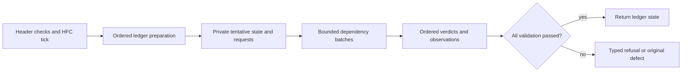

# Bounded parallel Plutus evaluation

**Status: Current, as built.** [D2 #21](https://github.com/KD5UJC-XYZ/scarab/issues/21);
[ADR 0018](../adr/0018-parallel-plutus-after-ordered-preparation.md).

## Execution and ownership

`MirrorRules.applyBlock` and `EraBlock.body` remain pure serial references. The effectful mirror
uses the same header validation and HFC tick, then hands an immutable `EraBlock.Body` to
`ParallelPlutus`. With one worker, or fewer than two redeemer-bearing transactions, it calls the
serial body directly. Otherwise `Body.prepare` runs the same BBODY/LEDGERS rules once, suppressing
only VM execution and observers at UTXOS after the existing phase-1 and script-integrity checks.
Block and transaction execution-unit caps still precede machines. Context collection still precedes
all scripts within its transaction.

A sealed, ledger-private recorder retains jobs. Each job contains the original transaction, exact
spent/reference outputs, parameters, era clock and immutable evaluator requests. The rules continue
using the transaction's advertised validity flag: normal spends/outputs when true; collateral
consumption/return when false. Certificate and governance rules are unchanged. The only information
deferred is the phase-2 verdict and its counters; those counters are not read by later ledger rules.
The tentative result is private to `EraBlock.Plan`. No caller can manufacture a completed value or
obtain its tentative state.

The graph includes every transaction, so non-script transactions transmit paths. Producer/consumer
and read-before-consume edges include normal inputs, reference inputs and collateral. Creation and
consumption use the validity flag; an invalid transaction creates its collateral return at index
`outputs.size`. Shared reference reads may overlap. A script job's level is one plus the largest
script level among its ancestors; ordinary transactions add no level. Batches run in level order.
This is conservative: all contexts have already been frozen before any worker starts. Full state
application and certificates are never executed concurrently.

Within each job every script runs in collection order; all failures, budgets and logs are retained
([I4 result aggregation](script-results.md)). One shared semaphore
bounds jobs across concurrent validations. Non-interruptible `blocking` holds each permit until its
machine returns, including cancellation. Joined fibers return `Phase2.Completed` values and hold no
`Raise`. The owner resolves them by transaction order, calls observers only for reached transactions,
and returns the original typed refusal, unavailability or raw defect. Later failures cannot overtake
earlier refusals. Missing or foreign completions are evaluated locally rather than accepted as a
success. Preparation retains an original raw defect alongside its recorded prefix. Earlier script refusals
still win; when that prefix passes, the original defect lands without a retry. A transient defect
cannot disappear because a second execution happened to succeed.

On success only phase-2 counters need reconstruction; the already-checked integrity counter comes
from preparation. On any refusal the entire tentative state is discarded. There is no state
publication, persistence, observer output or peer penalty from speculative later jobs. Worker memory
is bounded by one block per caller, and machine concurrency by the shared node bound. Cancellation
latency includes the remaining metered machine execution. A rejected block can perform speculative
later evaluations within the existing block budget. Calls outside the node's mirror (for example
single-transaction mempool admission) retain their serial interpreter.

## Reference correspondence

Pinned ledger source: `f649f9751074d2ab3de033fc3912f29c9862c1f5`,
[Alonzo/Plutus/Evaluate.hs, lines 134–177](https://github.com/IntersectMBO/cardano-ledger/blob/f649f9751074d2ab3de033fc3912f29c9862c1f5/eras/alonzo/impl/src/Cardano/Ledger/Alonzo/Plutus/Evaluate.hs#L134)
for request collection, and lines 187–207 for reference evaluation. The unchanged-reference
aggregation oracle now pins all pass/fail patterns in three scripts for each language, and serial/prepared paths retain every result. Exact reconstruction payloads match; native
diagnostic prose remains the optional presentation follow-up in
[#208](https://github.com/KD5UJC-XYZ/scarab/issues/208); result aggregation #195 is complete.
The graph follows
[CIP-31](https://cips.cardano.org/cip/CIP-0031) reference reads and
[CIP-40](https://cips.cardano.org/cip/CIP-0040) collateral returns. Parallel evaluation is a local
implementation choice, justified by immutable inputs and ordered landing, rather than a claim that
the reference node applies transactions concurrently.

## Regression controls and recorded-data contract

`PreparedBlockSuite` compares complete BBODY states, counters and ordered observations, including
producer-dependent spends, invalid-tag collateral, validity mismatches, unavailability, raw defects,
later ordinary refusals and absent/foreign completions. `TxDependenciesSuite` covers transitive
ordinary paths, shared reads, anti-dependencies, collateral return indices and a 20,000-transaction
chain on a 256 KiB stack. `ParallelPlutusSuite` proves actual overlap, one node-wide bound across
callers, cancellation joining, original defect identity and the transient-preparation-defect regression. CLI tests reject nonpositive bounds.

`PlutusReplaySuite` is opt-in offline evidence. Set `SCARAB_PLUTUS_CAPTURE` to a captured immutable
window containing `immutable/` and `records.jsonl` (chunk, byte offset, byte length, slot),
`SCARAB_PLUTUS_BASELINE` to the authenticated snapshot/checkpoint directory, and
`SCARAB_PLUTUS_OUTPUT` to a fresh writable scratch directory. Mount both inputs read-only. Its fixed
baseline is snapshot `snapshot-00000000000136511997-5300868.bin`; it verifies the snapshot format and
restores its checkpoint into a fresh store. For every later captured block it warms the original serial
interpreter, rotates it alongside 1/2/4/8-worker settings for three rounds, compares the complete mirror state after
each validation, then advances only the reference state/store. Timings include full validation with direct signature verification (no verification-pipeline cache) and
store reads, excluding comparisons, file loading, flushes and context recording. Run in the Docker
JDK image with `scripts/sbtw 'node/testOnly *PlutusReplaySuite'` and those environment variables.
Normal `check` skips only this externally supplied capture, not the deterministic regression controls.

The capture's integrity, baseline binding, sample limits and measured results are recorded in
[performance.md](../performance.md). These data establish serial/parallel equivalence on that
preprod window, not the complete historical Preview 242-failure/K1 acceptance of #21.

For a finished epoch comparison, use `scripts/oracle_compare.py diff --require-complete`;
`--expected-epochs 1451` also pins the historical Preview reference coverage. These acceptance
options reject empty references, duplicate epochs, missing points and wrong block hashes. The
default mode continues to report points still waiting for a running follower.

### Preview replay using the same runner

`PlutusReplaySuite` and `PreviewReplaySuite` both delegate to `RecordedReplay`; there is one
block-validation loop. The preprod entry point retains its pinned baseline, existing environment
variables and rotated measurement schedule. Preview supplies explicit native V5 snapshots and
separate UTxO checkpoints through the [failure-corpus exporter](../../fixtures/preview/phase2-failures/README.md).

Set `SCARAB_PREVIEW_WINDOWS` to the exported `windows.jsonl`,
`SCARAB_PREVIEW_GENESIS` to the absolute Preview genesis directory, and
`SCARAB_PREVIEW_WORKERS=4`, then run `scripts/sbtw 'node/testOnly *PreviewReplaySuite'` in Docker.
For a forked test JVM, set its heap explicitly (10 GiB for the largest captured states) and use
absolute input paths; sbt normally starts it in the node module directory. Mount capture records,
snapshots, checkpoints, genesis files and optional reference data read-only, with fresh writable
output paths supplied in the batch manifest.

The default `Comparison` schedule validates each block once serially and once at every requested
worker bound. It checks decoded block metadata, raw-byte hashes, parent links and block-number
continuity from the authenticated snapshot anchor. Complete mirror states and ordered typed
requests/results, used and declared budgets, native diagnostics and logs must agree. Unavailability
or collection failures refuse acceptance. Each window must reproduce its exact ordered invalid
transaction identities. Windows intentionally overlap; historical coverage is the unique union of
the pinned 242 identities, rather than the sum of window counters. `RotatedMeasurements` with
`SCARAB_PREVIEW_ROUNDS=3` adds warmed, rotated timing controls for a selected window; ordinary
comparison timings are not treated as that benchmark.

With `SCARAB_PREVIEW_REFERENCE` naming the authentic reference directory, reached reference points
also produce the follower's full-UTxO K1 projections. `K1OfflineMain` reuses the production
`ChainStorage.open` stored-block replay for the contiguous genesis prefix; it constructs no follower
or peer. The [staging recipe](../../fixtures/preview/phase2-failures/README.md) gives it private
indexes, format metadata and a writable tail, with older bodies linked into a read-only mount.
These are offline acceptance entry points, not additional transaction-application implementations.

## Accepted feature gates

Level 3, source `7ba8c7f3` (2026-10-19 UTC): Docker `check` passed 4,819 tests with 16 skips,
including fuzzing and scalafix. The external-data replay is one normal-check skip and was then run
explicitly with its inputs mounted read-only: 68,196 feature-versus-original complete state matches,
17,049 original-interpreter controls and 104,388 reached script evaluations per pass.

`python3 scripts/devnet.py --name scarab-parallel-plutus-e2e e2e`: 1,687 blocks through all seven eras,
66 equal ledger comparisons, zero validation/fatal/reconnect/starvation events, Conway epoch 17.
The reference CLI cannot query a Byron ledger directly; its UTxO is compared through Shelley entry.

`python3 scripts/devnet.py --name scarab-parallel-plutus-pool pool --seconds 180 --scala-flags
'--plutus-workers 4'`: 34 forged blocks, all 34 observed adopted (32 on the final chain after two slot
battles), 33/33 scheduled leaders in the oracle window, 7/7 equal ledger comparisons, 30 transactions
in Scala-forged blocks, zero forge failures, validation errors, reconnects or starvation warnings.

The scenario class directories matched each other and the compiled feature tree: normalized binary
inventory SHA-256 `322085ccb0b824c5a778b95f85a75bdb55546881c662c2622da6766acf66f73c`.
Area scenarios ran sequentially because another session occupied the other shared devnet slot. The
pre-hardening era run was superseded before completion; the accepted run above and final recorded
comparison use the final source. Owned clusters and build containers are removed after the gates.
The completed Preview reconciliation and owner-directed closeout for #21 are recorded in the
following section.

### Preview reconciliation gates

Level 4 evidence reconciliation for #21, 2026-10-19 UTC: source `e3dbe2da`, based on
`edf8a887`, passes Docker `check` (5,153 tests, 17 optional-data skips, all 14 modules, default fuzz and
scalafix) and 241 Python tests. Source `3c27c84c` passes private `e2e` with 1,663 block applications
and all 66 ledger comparisons equal through Conway epoch 17, with zero validation/fatal errors,
reconnects or starvation warnings. The explicitly required `soak --seconds 480` passes 24/24
comparisons, 258 block applications and both metrics endpoints' 230-series checks, with zero
validation errors or reconnects. Both private clusters and the build container were removed.
The [Preview measurement](../performance.md#33-preview-acceptance-evidence-reconciliation-21)
records its source/runtime binding and limits separately from the historical runs.

The preserved preprod `PlutusReplaySuite` entry point also passes on frozen source `2ffad2d8`:
5,683 original blocks, 85,245 timing rows (17,049 for serial and each 1/2/4/8-worker mode), with
complete current-rule state agreement. The original capture and native V5 snapshot match the
PR #196 hashes; all 16,529 runtime files/jars remain unchanged. Its current script counter is
104,392, versus 104,388 in the historical pre-aggregation run. This establishes entry-point
compatibility and current serial/parallel agreement, not historical counter identity or another
performance result. The independently rehashed ten-artifact validation manifest has SHA-256
`f89e9eeaad84c9530773746fab063de7dfa2db6e23db39d37e90c792e9882f9d`.

The complete 68-window Preview comparison passes 428,517 original blocks in both serial and
four-worker modes (857,034 full validations). Ordered invalid transaction lists agree with the
original bytes: 319 overlapping observations produce exactly the 242 pinned identities. Complete
states and ordered typed requests/results, budgets, diagnostics and logs agree. All 68 selected
Haskell boundary projections match with strict coverage, with zero unavailable/collection
failures. The accepted execution manifest and scope are recorded in
[performance section 33](../performance.md#33-preview-acceptance-evidence-reconciliation-21).
The continuous genesis-to-K1-endpoint run also passes: 4,758,521 original blocks through slot
125,366,428/hash `956541c0937e9cdc279514c10fec9706865bb6004ddcfb487bf53c7bbdc97ad1`, all
1,451 authentic Haskell projections equal under the existing projection contract, and the exact
ordered 242 invalid transaction identities. It evaluated 11,251,372 scripts; 244 scripts failed,
with zero unavailable or collection failures. Six responsiveness warnings are retained, rather
than inheriting the private e2e's zero-warning claim. The 6 h 12 m 05.190 s replay interval includes
projection exports and persistence; performance section 33 records the separate timer scopes.

The frozen runtime remains bound to production base `235cd12a`, tool `dc00416b`; subsequent
integration builds are recorded separately. The accepted K1 manifest has SHA-256
`489094c44e9e97793aba1371c65eb3643bb18c7bb8d3416d7ce5391fb5b9dcde`; independent integration
verification rehashed all 1,467 artifacts and checked the endpoint, strict reference coverage and
ordered invalid identities. Original archived inputs remain unchanged and the owned container is
removed. D2 acceptance merged in [PR #209](https://github.com/KD5UJC-XYZ/scarab/pull/209),
commit `2f1d18467527cd9ca0704a3ffcbc9d016a32fb1d`. The owner explicitly directed #21's closeout
and took responsibility for following up if [post-merge CI](https://github.com/KD5UJC-XYZ/scarab/actions/runs/39345316583)
fails. This records an owner-directed closeout without claiming that pending CI passed; the usual
[definition of done](../process.md#definition-of-done) is unchanged. Nightly CI remains the
continuing safety net, not an additional new run required before closing this item.
