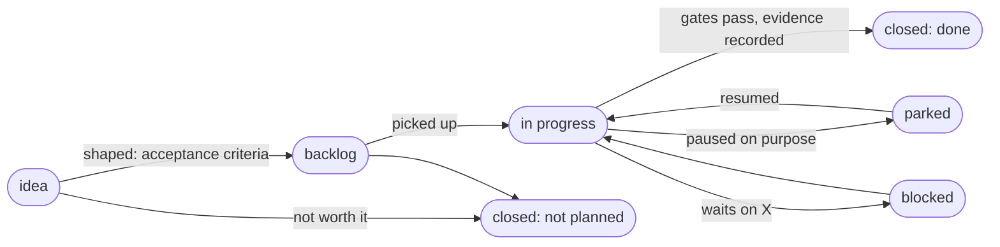

# How work moves

How Scarab's work is tracked, from an idea to a closed issue with evidence. It is written for the
owner, for contributors and for independent agent sessions working in parallel (see also
[AGENTS.md](../AGENTS.md)). The aim is a lean, flexible process: priorities can change at any time,
work can be parked and resumed, and nothing goes stale silently.

## One place per question

| Question | Source of truth | Kept current by |
|---|---|---|
| What work exists, and what state is it in? | [GitHub issues](https://github.com/KD5UJC-XYZ/scarab/issues), one per roadmap ID, with a `status:` label | whoever moves the work, when it moves |
| What is planned, grouped by area? | [roadmap.md](roadmap.md): one line per item, ID and issue link, done items marked | the change that finishes or adds an item |
| What goes into the next release? | [Milestones](https://github.com/KD5UJC-XYZ/scarab/milestones) (`v0.2`, `v0.3`, …) | triage |
| Why is it built this way? | [Architecture decision records](adr/README.md) | a new ADR when a decision is made or reversed |
| How will a large piece of work be built? | [Design documents](design/README.md): approved plans, with their stages | the plan's owner, as stages land |
| What is verified, against what? | [compatibility.md](compatibility.md) (matrix and evidence log) | the change that adds evidence |
| What changed? | [CHANGELOG.md](../CHANGELOG.md), and the fragments in [changes/](../changes/README.md) until a release folds them in | every change a user could notice, as a fragment |
| How fast and how large? | [performance.md](performance.md) | runs that measure |

Working notes, run logs and scratch analysis stay out of the repository (contributors keep them
locally; the maintainer's sessions use the ignored `.workspace/` directory). What a reader needs
later is distilled into one of the documents above.

## Lifecycle of an item

| State | How it shows | Meaning |
|---|---|---|
| idea | open issue, `status:idea` | captured, not yet shaped; anyone may add one at any time |
| backlog | open issue, no `status:` label | shaped: has scope and acceptance criteria, a priority (`priority:P0..P2`) and an area |
| in progress | `status:in-progress` | someone (a person or an agent session) is on it now |
| blocked | `status:blocked` | waits on another issue or a decision, named in a comment |
| needs owner | `status:needs-owner` | waits on a decision or an action only the owner can take |
| parked | `status:parked` | started and paused on purpose; the latest comment says what is done, where the branch is and how to resume |
| owner review | label `owner-review` | the owner's review feedback; triaged into a fix, a rule with a sweep, a design issue or an answer, each replied to with its commit ([CONTRIBUTING.md](../CONTRIBUTING.md#owner-review-feedback)) |
| done | closed as completed | the definition of done below holds; the closing comment carries the evidence |
| not planned | closed as not planned | decided against, with the reason in a comment (and an ADR if it was a design choice) |

**Spikes** (`kind:spike`) are time-boxed explorations. A spike ends in one of three outcomes, recorded
in its closing comment and, when it shapes the design, in an ADR: *adopt* (follow-up issues opened),
*park* (what was learned, what would restart it) or *drop*. A document produced by a spike says
"spike" in its status line until the outcome is decided.

### Now, next, later

- **Now**: issues labelled `status:in-progress`. Keep this short (about three parallel tracks); more
  than that means something should be parked.
- **Next**: the current milestone's open issues, by priority.
- **Later**: open issues with no milestone, and ideas.

### Changing course

Changing your mind is normal, not a failure of planning:

- **A new idea** becomes an issue with `status:idea` (or a line to the maintainer, who files it). It is
  shaped and placed at the next triage, not necessarily started.
- **A change of priority** is a label or milestone change, with one sentence on why.
- **An interruption** parks the current item: push or record the branch, write the resume comment,
  label it `status:parked`. Parked work is resumed from the comment, not from memory.
- **A reversed decision** gets a new ADR that supersedes the old one; the old one is kept and marked.

### Triage and health check

At each release milestone, and whenever the list feels stale:

- every open issue has an area and a priority, or `status:idea`;
- every `status:in-progress` issue really is moving, and every `status:parked` one has its resume comment;
- [roadmap.md](roadmap.md), the issue states and the milestones agree;
- every document's status line is still true (current, proposal, spike or historical);
- CI is green, including the nightly scenarios, and dependency updates (`dependencyUpdates`) are reviewed.

## Definition of done

An item is closed as done when all of these hold:

1. The change is on `main`, and the gates for its level passed
   ([CONTRIBUTING.md](../CONTRIBUTING.md#gates-and-ceremony-by-level-of-change)); the next nightly CI
   run is green.
2. Evidence is recorded where its level asks: a test or fixture always; the compatibility matrix for
   consensus-critical work (level 3); the evidence log for stage-boundary runs (level 4);
   performance numbers in performance.md.
3. A changelog fragment in `changes/` if a user could notice; the roadmap line is marked done (never
   renumbered or deleted).
4. Every gap the work leaves is tracked: a new issue or roadmap item, linked from the closing comment.
   "Not yet" in a document always points at an item.
5. The closing comment states what was done, the commit, and the evidence.

## Documents have a status

Each design or reference document starts with a status line:

- **Current**: describes what the code does now.
- **Proposal**: a plan or estimate, not scheduled or not started.
- **Spike**: exploratory work whose outcome is not decided.
- **Historical**: a record of a run or a decision, kept as it was.

When the code changes what a current document describes, the same change updates the document.

## Parallel work

Large items are split into stages or jumps in a design document, each small enough for one session.
Independent sessions work in separate git worktrees and separate build containers
([AGENTS.md](../AGENTS.md)), and each lands on its own when its level's gates pass
([CONTRIBUTING.md](../CONTRIBUTING.md#landing-in-parallel)); nightly CI runs the expensive scenarios
on what landed.
